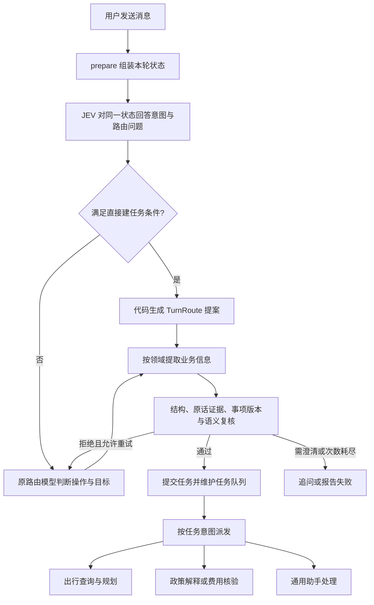

# JEV 接入原理与多意图改造详解

更新日期：2026-10-19

适用项目：Aligo 高校智能差旅助手（TourAgent）

读者：没有使用过 JEV、希望理解接入过程的产品与开发人员

本文解释三件事：怎样使用 JEV、项目最初怎样接入，以及为什么后来进行了多轮改造。示例围绕以下请求展开：

> 帮我查长沙到郑州的机票，另外解释一下学校的住宿报销标准。

全文区分三种材料：官方接口规范、当前工作区实现、项目历史与已保存测试结果。历史单选请求用于说明当时的结构，不代表当前还在使用；标注为“教学示例”的概率也不是实测值。2026-10-19 的真实分类验证使用 `jev-1.13.0`，不能直接代表其他版本或所有中文输入的表现。

## 阅读导航

| 想了解什么 | 阅读位置 |
|---|---|
| JEV 是什么，有哪些输入和输出 | 第 1～3 节 |
| 怎样发出一次真实请求 | 第 4 节 |
| 项目最初如何接入，为什么需要改造 | 第 5～7 节 |
| 现在怎样把多个意图变成任务 | 第 8～10 节 |
| `other` 为什么误判，具体修改了什么 | 第 11 节 |
| “只能第一次用”、任务队列和辅助分类是什么意思 | 第 12 节 |
| 怎样验证、是否真的节省 token、有哪些限制 | 第 13～16 节 |
| 到哪里看代码和官方资料 | 第 17～18 节 |

## 演进路线

| 阶段 | 遇到的问题或目标 | 采取的改造 | 能力变化 |
|---|---|---|---|
| 初次接入 | 简单意图仍需要调用通用路由模型 | 用 JEV Choice 分类，代码生成单任务提案 | 适用场景下可省去一次路由调用 |
| 政策定义细化 | 了解标准被识别成核验费用 | 详细定义具体情形与制度解释的正反边界，后来移除关键词纠偏 | 根据用户目的判断，避免只看词语 |
| 多意图改造 | 一句话有多个目标，单选只能表达一个 | 四道独立 Noul、复杂路由判断、按类别生成有范围的任务 | 可直接表达多个不同类别的独立新目标 |
| other 边界修订 | 机票和政策解释之外，多出一个 other | 强化公共规则、other 定义与专属排除条件 | 已测原句只保留两个正确目标，同时保留业务与天气等混合请求 |

## 1. 从零理解 JEV

### 1.1 它在这里承担什么工作

JEV 是 TypeSafe 提供的、用于结构化判断的模型。使用时，我们把待判断的材料和一道或多道问题发送给服务，取回程序可以直接读取的答案。它的使用方式见官方 Primitives 和 API 文档，参考第 18 节的 O1、O2。

以差旅助手为例，程序在调用查询或政策模块之前，先需要回答：

- 用户想查机票，还是查住宿报销规定？
- 用户是在了解制度，还是判断某笔费用能否报销？
- 这句话是否还包含一个需要另外处理的天气或偏好请求？

本项目让 JEV 回答这些分类问题。它返回类别或概率，程序据此选择后续处理路径。

### 1.2 先区分五个容易混淆的概念

| 概念 | 通俗解释 | 例子 |
|---|---|---|
| 意图 | 用户想达到哪种目的 | 查询机票、解释政策 |
| 路由 | 决定由哪条流程处理，以及如何关联事项 | 新建查询任务，或修改已有查询任务 |
| 槽位 | 执行任务所需的具体信息 | 出发地长沙、目的地郑州、出发日期 |
| 任务 | 系统需要单独跟踪的一件事 | 查询某次长沙到郑州的机票 |
| 执行 | 真正调用业务能力并产出结果 | 查询供应商、检索政策、生成答复 |

“知道用户要查机票”不等于“已经知道哪一天”，也不等于“已经查到了航班”。这三件事分别属于意图识别、信息提取和业务执行。

### 1.3 项目的四种意图

| 内部名称 | 中文含义 | 典型请求 |
|---|---|---|
| `plan_trip` | 查询或规划交通、酒店、行程 | 帮我查长沙到郑州的机票 |
| `policy_check` | 核验具体费用或情形是否符合差旅政策 | 这笔500元住宿费能报销吗 |
| `policy_explain` | 查阅或解释差旅制度本身 | 学校住宿报销标准是多少 |
| `other` | 三类业务之外的独立通用请求 | 查天气、保存长期偏好、普通对话 |

这些名称是项目定义的业务分类，不是 JEV 内置的差旅知识分类。JEV 如何理解它们，取决于我们在请求中提供的定义。

取消、恢复、重试和丢弃失败回合不是第五个意图，也不算 `other`。它们由原路由的任务控制或失败恢复绑定目标。保存当前出差、确认事实和阅读已返回结果仍算 `other`，因为当前只有 `other` 任务会进入调用 `save_trip` 和 `read_task_result` 的助手节点。

## 2. 使用 JEV，需要发送什么

### 2.1 一次请求的三个主体字段

官方 HTTP 请求使用以下主体结构：

```json
{
  "model": "jev-latest",
  "state": {
    "user_message": "帮我查长沙到郑州的机票"
  },
  "questions": {
    "has_plan_trip": {
      "type": "noul",
      "instructions": "本轮 `user_message` 是否要求查询或规划交通、酒店或行程？",
      "criteria": {
        "true": "用户要求进行新的交通、酒店或行程查询；条件不全也算。",
        "false": "用户没有提出此类请求，或仅询问报销制度。"
      }
    }
  }
}
```

这是教学用的最小请求，不是项目实际发送的完整问题集合。

| 字段 | 由谁提供 | 含义 |
|---|---|---|
| `model` | 调用方 | 选择使用的模型或模型别名 |
| `state` | 调用方 | 待判断的内容和相关背景 |
| `questions` | 调用方 | 希望模型回答的问题集合 |
| `instructions` | 调用方 | 把具体要判断的命题说清楚 |
| `criteria` | 调用方 | 定义什么情况算是、什么情况算否，或各选项的边界 |

可以把 `state` 理解为题目材料，把 `questions` 理解为试题，把 `criteria` 理解为判定标准。

### 2.2 当前项目实际传入的 state

当前入口在 `graph.py` 的 `prepare()` 中组装以下信息：

```json
{
  "user_message": "帮我查长沙到郑州的机票，另外解释一下学校的住宿报销标准",
  "conversation": [
    "帮我查长沙到郑州的机票，另外解释一下学校的住宿报销标准"
  ],
  "current_slots": {},
  "task_context": [],
  "pending_tasks": [],
  "pending_turns": []
}
```

这是与空业务状态对应的示例；实际已有信息时，相应字段会包含内容。

| 字段 | 提供它的原因 |
|---|---|
| `user_message` | 明确本轮需要识别的原话 |
| `conversation` | 帮助理解“那里”“改成后天”等省略和指代 |
| `current_slots` | 告知当前已有的出行或费用信息 |
| `task_context` | 告知已有任务，辅助区分新建和修改 |
| `pending_tasks` | 告知尚待处理的任务 |
| `pending_turns` | 告知失败后尚未提交的请求，避免把恢复当作新建 |

一个实现细节：当前 JEV 的 `conversation` 是历史**用户消息文本列表**，并非包含助手回复和工具结果的完整聊天记录。不能把该字段的实际内容想象得比代码提供的更丰富。

### 2.3 为什么不能只写一个看起来很清楚的字段名

`has_other_request` 是程序给问题取的 ID，用来从返回结果里找到对应答案。

根据官方文档，问题 ID 不会发送给底层模型参与判断。因此，不能只依赖这个名字表达“请判断是否存在其他请求”。必须在 `instructions` 中把问题写完整，并在 `criteria` 中说明边界。参考 O1、O3。

当前实现会为每个问题附加各自的目标说明，避免四个问题只有相同的公共指令。

## 3. JEV 返回什么，怎样选择问题类型

### 3.1 本项目涉及的两种类型

| 类型 | 相当于什么题 | 输出 | 本项目用途 |
|---|---|---|---|
| `Choice` | 单选题 | `choice`、各选项 `probabilities`、`confidence` | 最初的单意图分类；当前请求不再发送 Choice |
| `Noul` | 判断题 | `noul`，0～1 的“是”概率 | 当前四种意图的独立存在判断，以及复杂路由判断 |

官方还提供 `Score` 用于有等级标准的评分，本项目这次改造没有使用。类型选择见 O1，具体输出见 O3、O4。

### 3.2 Choice 为什么不适合直接表达多个意图

教学示例：

```json
{
  "answers": {
    "intent": {
      "type": "choice",
      "choice": "plan_trip",
      "probabilities": {
        "plan_trip": 0.90,
        "policy_check": 0.02,
        "policy_explain": 0.06,
        "other": 0.02
      },
      "confidence": 0.80
    }
  }
}
```

这个示例的数值仅用于展示结构。`choice` 仍然只表达一个被选中的选项；其他选项有概率，不等于系统已经选择了多个目标。

因此，当用户同时要求查机票和解释政策时，不能仅靠把单选题描述写长，就让单个 `choice` 自然变成多选结果。

### 3.3 Noul 的数值是什么意思

```json
{
  "answers": {
    "has_plan_trip": {"type": "noul", "noul": 0.98},
    "has_policy_explain": {"type": "noul", "noul": 0.97}
  }
}
```

这里分别表示模型对两个“是否存在”的问题倾向于回答“是”。它不表示“出行任务完成了98%”，也不表示“政策解释质量是97分”。

不同 Noul 问题各自判断，所以两个值都很高是允许的，它们不需要加起来等于1。Noul 没有单独的 `confidence` 字段；不能把 Choice 的返回结构原样套过来。参考 O3。

### 3.4 同批问题独立判断意味着什么

我们可以在同一个 HTTP 请求里发送多道问题，所有问题使用相同的 state。但一道问题的答案不会自动成为另一道题的上下文。

例如，不应该把 `other` 描述写成“如果前面几个问题都没命中就选我”，并期待 JEV 在这一批中读取前几道题的答案。

本项目的做法是：直接在 `other` 这道题里定义三类业务目标的范围，再问原话中是否还存在范围之外的独立请求。它根据原话判断，保持一次请求即可得到需要的分类结果。参考 O1。

## 4. 怎样完成一次最小接入

### 4.1 HTTP 调用方式

官方评估端点为：

```http
POST https://api.typesafe.ai/v1/systemone
Authorization: Bearer <API_KEY>
Content-Type: application/json
```

密钥通过私密环境配置提供，不写进代码或文档。项目使用已有 `httpx` 直接调用接口，没有为这次接入新增 TypeSafe SDK。官方 SDK 是另一种接入方式，但不是本项目的依赖。接口规范见 O2。

### 4.2 可运行的教学代码

下面的 Python 示例只问“查询出行”和“解释政策”两道题，帮助理解接口使用。它不是完整的项目路由器，不包含费用核验、other 和任务管理。

依赖使用项目已安装的 `httpx`。运行时由环境注入 `JEV_API_KEY`；可选注入 `JEV_MODEL`、`JEV_BASE_URL`、`JEV_ENDPOINT` 和 `JEV_TIMEOUT_SECONDS`。此独立示例读取进程环境，不自动加载 `.env`。

```python
import json
import os

import httpx


def classify_example():
    api_key = os.environ.get("JEV_API_KEY", "").strip()
    if not api_key:
        raise RuntimeError("请先通过私密环境配置提供 JEV_API_KEY")

    base_url = os.environ.get("JEV_BASE_URL", "https://api.typesafe.ai").rstrip("/")
    endpoint = os.environ.get("JEV_ENDPOINT", "/v1/systemone")
    timeout = float(os.environ.get("JEV_TIMEOUT_SECONDS", "15"))
    payload = {
        "model": os.environ.get("JEV_MODEL", "jev-latest"),
        "state": {
            "user_message": "帮我查长沙到郑州的机票，另外解释学校住宿标准"
        },
        "questions": {
            "has_plan_trip": {
                "type": "noul",
                "instructions": "本轮 `user_message` 是否要求查询或规划交通、酒店或行程？",
                "criteria": {
                    "true": "要求进行新的查询或规划；日期等条件不全仍算。",
                    "false": "没有该目标，或仅询问报销规定、核验费用。",
                },
            },
            "has_policy_explain": {
                "type": "noul",
                "instructions": "本轮 `user_message` 是否要求查阅或解释差旅制度？",
                "criteria": {
                    "true": "要求了解标准、限额、规则含义或政策依据。",
                    "false": "没有该目标；仅核验具体费用时附带引用规则不算。",
                },
            },
        },
    }
    try:
        response = httpx.post(
            base_url + endpoint,
            headers={"Authorization": "Bearer " + api_key},
            json=payload,
            timeout=timeout,
        )
        response.raise_for_status()
        result = response.json()
    except (httpx.HTTPError, ValueError):
        raise RuntimeError("JEV 请求失败：检查网络、状态码及请求格式") from None
    if not isinstance(result, dict) or not isinstance(result.get("answers"), dict):
        raise RuntimeError("JEV 响应缺少有效 answers，交给备用流程处理")
    return result


if __name__ == "__main__":
    print(json.dumps(classify_example(), ensure_ascii=False, indent=2))
```

这段代码会产生一次真实、可能计费的分类请求，不会查询机票或办理预订。它只演示发请求和读取响应；生产应用还需要检查每个答案的类型、数值、完整性，并设计失败和不确定时的回退，项目实现见第 10、13 节。

### 4.3 在本项目中应优先使用已有适配器

实际集成无需重复编写 HTTP 请求，可以通过已有类调用：

```python
from business_travel.jev import JevClient
from business_travel.settings import Settings


def inspect_request(text):
    settings = Settings.from_env()
    state = {
        "user_message": text,
        "conversation": [text],
        "current_slots": {},
        "task_context": [],
        "pending_tasks": [],
        "pending_turns": [],
    }
    decision = JevClient(settings).classify(state)
    return {
        "status": decision.status,
        "error_code": decision.error_code,
        "answers": decision.answers,
        "hint": decision.hint(),
        "route": decision.primary_route(state),
        "usage": decision.usage,
    }
```

`Settings.from_env()` 会使用项目的环境读取规则：系统环境变量优先，默认还会读取项目根目录 `.env`；`TRAVEL_LOAD_DOTENV=0` 可关闭文件加载。这个教学函数只返回结果，不执行后续业务。

## 5. 最初怎样接入：单选分类替代一次路由调用

### 5.1 没有 JEV 时的理解流程

原有入口使用通用模型调用 `TurnRoute` 工具，识别用户目标、事项归属、新建或更新操作等。随后按领域提取信息，校验后建立任务并执行。

```text
用户原话
  -> 路由模型提出 TurnRoute
  -> 出行/费用领域信息提取
  -> 结构与证据校验、语义复核
  -> 提交任务并进入队列
  -> 执行查询或政策处理
```

### 5.2 初次接入的设计

2026-10-09 的项目记录显示，JEV 接在主图 `prepare()`，即理解阶段的入口。最初发送四类 Choice 问题：

| 问题 | 当时希望得到的结果 |
|---|---|
| `intent` | 四类意图中选择一个 |
| `query_scope` | 交通、酒店、综合 |
| `transport` | 飞机、火车、比较两者 |
| `journey` | 单程、往返 |

这些是历史结构的概述，依据项目过程记录，不是当前请求体的逐字副本。

对于空业务状态、可以用单个新任务表达的请求，代码把 JEV 的意图转换为符合 `TurnRoute` 结构的本地提案，省去通用路由模型调用。信息提取、证据检查、语义复核和执行门禁继续运行。

遇到已有任务、无效结果或服务失败时，保留原模型路由。项目同时保留 `primary` 和 `shadow` 两种模式，详细区别见第 12 节。

### 5.3 当时想节省的是什么

目标是让适合结构化判断的分类由 JEV 承担，减少通用模型在这一环节的调用和输入输出。

这并不是对用户原话做文本压缩，也不是让 JEV 完成机票查询或政策检索。它替换的是适用场景下的一次“决定怎么处理”的模型调用。

是否最终省 token、费用或时间，要把新增的 JEV 开销一起计算，见第 15 节。

## 6. 第一次语义改造：区分“了解规定”和“核验费用”

### 6.1 遇到的问题

早期 `policy_check` 的描述接近“核对报销、差旅政策或合规条件”，`policy_explain` 接近“解释差旅政策、规则或条款含义”。两个定义都涉及政策，动作边界不充分。

例如：

> 我是院士，去北京出差，住宿标准是多少？

用户要了解适用标准，属于政策解释。如果识别成费用核验，下游会按具体费用的要求检查条件，可能在没有费用日期等信息时提前追问，而没有进入预期的政策解释流程。

这说明路由错误会改变后续流程。检索没发生，可能是前面的理解或校验阻止了执行；不能一看到“没有检索结果”，就认定检索系统出了问题。

### 6.2 描述如何细化

| 判断维度 | `policy_check` | `policy_explain` |
|---|---|---|
| 用户想获得什么 | 具体费用或情形是否符合政策的判断 | 制度标准、含义、条件、依据 |
| 是否一定已经支付 | 不一定，也包括拟发生和明确假设 | 不以具体支付为前提 |
| 条件不全怎么办 | 仍然识别为核验，随后收集事实 | 仍然识别为解释，随后补充必要适用条件 |
| 出现身份、城市、日期 | 用于理解具体情形 | 不能仅凭这些信息就改判为核验 |
| 出现金额、发票等词 | 需判断是否在核验费用 | 也可能只是在解释条款中的概念 |

例如，“规定中的500元上限怎么理解”仍可能是解释；“如果我住500元一晚能否报销”是具体假设情形的核验。

### 6.3 中间尝试及最终选择

项目中间曾加过本地关键词纠偏：JEV 返回核验后，程序再检查是否出现“标准、规定”等线索并改写意图。

随后按项目需求移除了这些规则，保留 JEV 返回的类别，通过更详细的判断标准减少混淆。原因是词语和用户目的并非一一对应，简单词匹配容易改错含有具体假设、否定和混合目标的请求。

当前没有“出现住宿标准就强制改成解释”这样的本地纠偏。

早期单选版本还使用过“核验优先”的规则。后来的多意图版本已经改为保留独立目标：核验所需的附带解释不另建任务，但用户另外明确要求了解规定时，核验和解释可以同时成立。

## 7. 第二次结构改造：从单意图变为多意图

### 7.1 为什么继续修改单选描述还不够

贯穿全文的原话中，用户提出了两个目标：查询机票、解释住宿报销标准。

原来的 `intent` 只有一个 Choice 结果。不管定义写得多精细，它都不能直接在一个被选中的选项中表达“这两件事都要做”。如果再让通用模型从整句重新拆任务，就难以达到简单场景下省掉那次路由模型调用的目标。

因此，需要改变返回结果所能表达的内容，而不只是调整某个词。

### 7.2 改成四个独立存在判断

当前使用四个 Noul 问题：

| 问题 ID | 正文实际要判断的命题 |
|---|---|
| `has_plan_trip` | 本轮是否存在出行查询或规划目标 |
| `has_policy_check` | 本轮是否存在具体费用或情形核验目标 |
| `has_policy_explain` | 本轮是否存在政策查阅或解释目标 |
| `has_other_request` | 本轮是否存在额外的通用助手请求 |

结果可以同时接受多个类别，也可以只接受一个类别。单意图并没有变成多任务：只有一个类别命中时，代码仍只创建一个新任务，并保持兼容的单个 `intent` 提示字段。

### 7.3 为什么还增加第五道 Noul 题

知道有哪些类别，还不等于知道完整任务结构。当前增加了 `requires_task_routing`，判断“每种意图各一个独立新任务”是否不足以表达用户需求。

| 请求 | 仅有类别为什么不够 |
|---|---|
| 核验两笔不同住宿费 | 两笔都属于核验，但需要区分事项 |
| 先查清标准，符合条件再查酒店 | 存在指定顺序或条件依赖 |
| 把刚才的出发日期改成后天 | 需要找到已有任务并更新 |
| 取消第二个任务 | 需要选择控制对象 |
| 重试上一次失败的查询 | 需要识别恢复对象和授权 |

该题回答“需要”或回答不明确时，由原有 `TurnRoute` 处理更丰富的任务结构。

### 7.4 一次请求中共有几道题

当前在一次 HTTP 请求中发送意图和路由判断：

```text
4 道意图存在判断（Noul）
+ 1 道复杂路由判断（Noul）
= 5 道问题，1 次正常评估请求
```

有待追问时，最前面再加 1 道“是否回答待补字段”。范围、交通方式和单程往返不再询问。

网络或服务错误可能导致 HTTP 重试，因此“一次正常请求”不等于任何情况下网络上都只有一次发送。

## 8. 当前代码怎样把答案变成任务

### 8.1 先解析，拒绝异常答案

`JevClient.classify()` 接收 HTTP 响应，提取 `answers`、模型标识和 `usage`。`_noul_answer()` 再检查具体判断值：

- 答案必须是对象，且 `type` 为 `noul`。
- `noul` 必须是有效数字，不能把 `true` 当作数值1。
- 数值必须在0～1范围内，字符串、NaN、无穷大等不能通过。

`status="ok"` 只说明接口返回了可以进入后续处理的答案对象，不保证每道题都完整有效，更不保证语义一定正确。能否直接建任务，还要继续检查。

### 8.2 再生成两种不同用途的结果

| 结果 | 方法 | 作用 |
|---|---|---|
| 分类提示 `hint` | `decision.hint()` | 提供明确正例、未决项、明确否定和复杂路由三态，供原路由参考 |
| 直接路由提案 `route` | `decision.primary_route(state)` | 条件满足时由代码创建任务结构，跳过路由模型 |

有 hint 不代表一定有 route。例如某些意图明确、但另一项判断不确定时，可以保留分类提示，同时交给原路由完整判断。
回退时交给原路由的就是 `hint()`。它带明确正例、未决项、明确否定，以及 `requires_task_routing` 的三态。原话明确要求的目标要保留，明确没有的不要建；`rejected_intents` 只是倾向没有，不能禁止原话里写明的目标。未决或缺失都不是否定。含义或目标仍分不清时才澄清，并且不能同时提交任务。

直接建任务不再按查询词或控制词否决。观察里的 `routing_hint` 与 `hint` 相同，只保留字段名。取消、恢复、重试和丢弃仍不是意图；只有 Jev 把复杂路由判为需要、任一项未决，或已有事项、待办、失败回合、追问时，才不跳过原路由。待追问捷径也不再因为句中出现控制词而整轮退回。

### 8.3 用真实结果走一遍

2026-10-19 保存的修改后结果，取五个 Noul 字段如下：

```json
{
  "has_plan_trip": {"type": "noul", "noul": 0.98},
  "has_policy_check": {"type": "noul", "noul": 0.09},
  "has_policy_explain": {"type": "noul", "noul": 0.97},
  "has_other_request": {"type": "noul", "noul": 0.05},
  "requires_task_routing": {"type": "noul", "noul": 0.14}
}
```

在默认阈值下，程序解释为：需要出行查询、需要政策解释；不需要费用核验、不存在额外通用请求；也没有明确需要复杂路由。

于是得到：

```json
{
  "intents": ["plan_trip", "policy_explain"],
  "undecided_intents": [],
  "rejected_intents": ["policy_check", "other"],
  "requires_task_routing": "no"
}
```

空业务状态等其他条件也满足时，代码按这两个类别创建新任务。以下是便于阅读的概念结构，实际 `question` 还会保留完整原话和任务范围说明：

```json
{
  "tasks": [
    {
      "operation": "new_task",
      "intent": "plan_trip",
      "question": "只处理原话中的出行查询目标，并附完整原话",
      "depends_on": []
    },
    {
      "operation": "new_task",
      "intent": "policy_explain",
      "question": "只处理原话中的政策解释目标，并附完整原话",
      "depends_on": []
    }
  ],
  "task_controls": [],
  "recovery": null,
  "clarification": ""
}
```

JEV 本次没有返回“长沙”和“郑州”这两个自由文本槽位，也没有替我们生成任意长度的任务清单。这些任务是 Python 代码根据接受的类别生成的。

### 8.4 为什么每个任务还要带范围说明

如果把完整混合请求原样交给两个执行模块，两边都可能试图回答整句，造成重复处理或条件串用。

当前多任务的 `question` 会说明“本任务仅处理某类独立目标，其他目标由其他任务处理”，同时保留完整原话供后续读取相关条件、否定、归属与假设。

这样做保留了信息来源，又明确了分工。它仍是范围指令，不是理解正确的数学保证；领域提取和独立复核继续承担检查职责。

## 9. 任务产生后，是否有固定步骤

当前流程可以用下图理解：



没有 Mermaid 渲染能力时，可按文字顺序阅读：先理解和提案，再提取与校验，通过后进队列，最后执行。图中重试为简化表达；实际代码会携带校验反馈，并受次数和错误类型约束。

其中“按领域提取”也有固定分工：

| 任务类别 | 当前提取工具 | 主要工作 |
|---|---|---|
| `plan_trip` | `TripExtraction` | 提取城市、交通条件、日期等出行信息 |
| `policy_check`、`policy_explain` | `ExpenseExtraction` | 提取费用事实或政策查询条件，按意图区分含义 |
| `other` | 不加载上述领域提取工具 | 进入对应通用助手能力 |

因此既有动态任务，也有固定处理流程。用户提出的目标决定任务内容；代码规定每种任务经过哪些提取、校验和执行环节。

缺少出发日期时，可以已经识别出“查机票”这个意图，但仍需要下游追问日期。分类成功不代表业务可以立即完成。

## 10. 默认阈值和回退规则

### 10.1 如何把概率变成决定

阈值来自 `JEV_INTENT_THRESHOLD`，默认 `0.8`，允许范围为 `0.5 < threshold <= 1`。

设阈值为 T，概率为 p：

| 条件 | 含义 | 默认阈值示例 |
|---|---|---|
| `p >= T` | 明确接受“有这个目标” | 0.97 |
| `1 - p >= T` | 明确接受“没有这个目标” | 0.05 |
| 两者均不满足 | 不确定 | 0.45 |

默认情况下可近似理解为：0.8及以上是肯定，0.2及以下是否定，中间区间回退。精确边界按代码的浮点比较执行。

### 10.2 为什么所有意图都要判定明确

假设出行查询为0.98，但政策解释为0.55。只创建出行任务，可能漏掉另一个尚未判清的目标。

因此，直接建任务要求四个意图的肯定或否定都明确，不是只看某一个高分。`requires_task_routing` 也必须明确为否，且至少命中一个意图。

四个意图全部明确为否时，也不会强行塞一个 `other`。系统交回原路由判断，避免把“没有识别到”直接等同于“用户在闲聊”。

### 10.3 哪些情况下不直接采用 JEV 任务提案

| 条件 | 当前行为或原因 |
|---|---|
| JEV 关闭、缺密钥或接口失败 | 保留原路由 |
| state 或当前消息无效 | 不生成直接路由 |
| 已有相关业务槽位或任务上下文 | 需要判断新建、修改、目标归属 |
| 有待办或失败待恢复请求 | 避免重复创建任务或错误恢复 |
| 任一意图缺失、格式非法、概率不确定 | 不直接建任务；这些项进入 `undecided_intents`，明确否定进入 `rejected_intents`，由原路由按原话处理 |
| 复杂路由判断为是或不确定 | 由原路由处理拆分、依赖和控制 |
| 所有意图均未命中 | 不自动转换为 other |
| 生成的提案不满足协议或绑定条件 | `propose_slots()` 退回原路由 |

这套规则控制的是“是否跳过原路由模型”，不是承诺 JEV 永远不会误判。

## 11. 第三次语义改造：修正 other 重复命中

### 11.1 实际出现了什么问题

用户提供的截图中，贯穿示例被判断为：出行查询、政策解释、other。随后使用同一原句和空业务状态发起真实 JEV 请求，复现了 `has_other_request=0.91`。

该原句没有额外的天气、偏好或聊天目标。解释住宿报销标准已经属于政策解释，因此多出来的 other 是误判。

这证明了该例存在错误，但不能证明模型内部究竟是被哪一个词影响。我们针对描述中可见的类别重叠提出修订，并通过前后对照验证效果。

### 11.2 原描述为什么需要加强

旧 other 描述覆盖“阅读或解释已返回的候选、合规结论或不确定性”，还允许与业务目标同时成立。

这两个设计本身有业务用途，但需要更清楚地区分：

- “解释已经给出的核验结果为什么不确定”：可以是结果解读。
- “解释学校住宿报销标准”：是了解制度，属于政策解释。

不能仅因为二者都用了“解释”这个动作词，就同时创建 other。

### 11.3 实际修改了哪三层描述

| 修改位置 | 新增或加强的规则 | 目的 |
|---|---|---|
| 公共 `INTENT_INSTRUCTIONS` | 只判断当前原话；历史用于指代；同一目标不因不同动作词重复归类 | 控制当前目标和重复分类 |
| other 的肯定定义 | 列明三类业务排除范围；必须存在范围之外的独立通用请求 | 明确 other 的含义 |
| `INTENT_EXCLUSIONS["other"]` | 全部请求都属于业务目标时应为假，并给出混合业务反例 | 给 other 专门的否定边界 |

同时，为每道题增加具体目标说明，避免依赖问题 ID。四类意图仍在同一次请求中分别判断。

### 11.4 最重要的对照例子

| 原话 | 应有意图 | 为什么 |
|---|---|---|
| 查机票，另外解释住宿报销标准 | 出行查询＋政策解释 | 两个目标均属于业务类别 |
| 查机票，另外查天气 | 出行查询＋other | 天气是额外的通用请求 |
| 核验住宿费，并记住我优先住安静房间 | 费用核验＋other | 保存长期偏好是独立动作 |
| 你好，麻烦解释住宿标准，谢谢 | 政策解释 | 礼貌用语不单独产生任务 |
| 你好 | other | 单独的普通对话 |
| 核验这笔住宿费，并说明判断理由 | 通常为费用核验 | 理由可以是该次核验的组成部分 |
| 核验这笔住宿费，另外解释学校住宿标准 | 费用核验＋政策解释 | 另外要求了解制度本身 |

### 11.5 为什么没有加“命中业务就关闭 other”

这种代码规则会使“查机票＋查天气”只能剩下机票查询，破坏真实的混合请求。

我们保留多个类别共存的能力，修改的是每一类的语义边界，不在本地把模型答案按某句关键词改写，也没有通过提高阈值掩盖0.91的高概率误判。

### 11.6 真实对照结果

| 项目 | 修改前真实请求 | 修改后保存的真实请求 |
|---|---:|---:|
| 出行查询 | 0.96 | 0.98 |
| 费用核验 | 0.08 | 0.09 |
| 政策解释 | 0.97 | 0.97 |
| other | **0.91** | **0.05** |
| 需要复杂路由 | 0.14 | 0.14 |
| 接受的意图 | 出行查询、政策解释、other | 出行查询、政策解释 |

修改后的该句在两次真实请求中均得到正确意图。表格采用已保存对照批次的修改后数据；用户最初截图和另一次请求的个别值略有差异，不混合当作同一响应。

## 12. 回答三个架构疑问

### 12.1 为什么有时说 JEV 只是“辅助分类”

要看当前模式和是否满足直接路由条件：

| 情况 | JEV 的实际作用 |
|---|---|
| `primary` 且满足直接路由条件 | 代码根据 JEV 结果创建提案，跳过原路由模型；并非只作参考 |
| `primary` 但需要原路由 | 提供独立分类提示，由原路由结合当前消息和已有事项判断 |
| `shadow` | 调用并记录 JEV，但不把 hint 或 route 注入路由流程 |
| 关闭或调用失败 | 使用原有链路 |

字段名叫 `hint` 不代表所有场景都只辅助；是否真正替代路由，要看 `route` 是否被创建和接受。

`shadow` 适合比较结果，但由于原路由仍执行，它不能按“省掉路由调用”来计算收益。

### 12.2 为什么“只在第一次能用”不准确

当前 `prepare()` 在有本轮文本消息时会尝试调用 JEV。不是只有聊天第一轮才调用。

需要区分两个限制：

1. **业务状态限制**：只有没有相关业务槽位、任务上下文、待办或失败待恢复记录等条件满足时，才允许 JEV 直接创建新任务。
2. **本轮重试限制**：同一轮提案的首次尝试可使用 JEV route；若被校验或复核拒绝，后续重试清除该 route，让原路由带着反馈重新安排任务。

第一个限制避免“改成后天”被误当新行程；第二个限制避免一个错误任务结构在重试中被原样反复提交。

这属于当前项目接入范围与表达能力的限制，不是官方 API 规定 JEV 只能调用一次。当前实现也偏保守：只要存在任务上下文，就放弃直接建任务，即使本轮其实是一个简单的新请求。

### 12.3 为什么没有把 JEV 搬到任务队列之后

队列里的任务本来就需要先经过目标识别、任务安排和校验才能建立。将同一类意图判断放在取出任务之后，不能替代之前建立队列所需的判断，反而可能重复分类或重新解释任务意图。

当前入口位置有明确用途：在任务产生前识别用户目标；简单场景直接产生提案，复杂场景交给原路由。

如果未来要在执行前再加一次检查，需要单独定义它检查什么，以及错误时如何处理。这不是本次多意图改造已实现的功能。

## 13. 配置、错误处理与观测

### 13.1 配置项目

以下为非敏感默认示例，真实密钥保持为空：

```dotenv
JEV_ENABLED=1
JEV_MODE=primary
JEV_API_KEY=
JEV_BASE_URL=https://api.typesafe.ai
JEV_MODEL=jev-latest
JEV_ENDPOINT=/v1/systemone
JEV_TIMEOUT_SECONDS=15
JEV_INTENT_THRESHOLD=0.8
```

| 配置 | 作用 |
|---|---|
| `JEV_ENABLED` | 是否启用调用；当前按字符串 `1` 判断开启 |
| `JEV_MODE` | `primary` 参与路由；`shadow` 仅对照观测 |
| `JEV_API_KEY` | 服务鉴权密钥，与通用模型密钥分开 |
| `JEV_BASE_URL`、`JEV_ENDPOINT` | 组装服务地址 |
| `JEV_MODEL` | 选择模型或别名 |
| `JEV_TIMEOUT_SECONDS` | HTTP 超时参数，配置允许1～120秒 |
| `JEV_INTENT_THRESHOLD` | 肯定和否定的判断阈值 |

超时参数不等于整轮请求的总耗时上限，因为还有多次尝试和后续处理。

`jev-latest` 是别名，后续可能指向其他版本。应记录响应中的实际 `model` 并在模型升级后重新验证，不能假定别名永远对应本文测试版本。参考 O5。

### 13.2 当前适配器如何处理失败

| 情况 | 实现行为 |
|---|---|
| 关闭 | 返回 `disabled`，不发 HTTP 请求 |
| 缺少密钥 | 返回 `missing_key`，不发 HTTP 请求 |
| 网络错误或超时 | 最多尝试3次，失败后返回错误供原路由处理 |
| HTTP 429、502、503、504 | 最多尝试3次，按现有退避逻辑处理 |
| 其他 HTTP 错误 | 不按上述列表重试，返回错误并回退 |
| 顶层 answers 非法 | 作为异常响应处理 |

同一次适配器调用的重试共用一个 `Idempotency-Key`；下一轮调用会获得新标识。这是当前客户端发送行为的说明，不在本文承诺服务端去重范围或重试一定不重复计费。

官方 API 文档还列出 `529 Overloaded` 并建议退避重试，但当前自写客户端的可重试状态列表尚未包含529。它会走错误回退，不应把官方 SDK 的默认能力当作本项目已经具备的能力。

### 13.3 到哪里观察效果

项目以 `jev_decision` 记录该次分类，包含可用的用量数据；开启内容观测时，输入和输出还受项目观测开关与脱敏规则控制。

适配器保留合法的 `input_tokens`、`output_tokens`、`total_tokens`、`charged_tokens`；输入输出存在但 total 缺失时，会在本地求和。不是每个响应都保证提供所有这些字段。

业务状态还保存 status、hint、route、error_code 和模型标识。排查时应沿同一请求查看：JEV 判断、是否采用直接路由、领域提取、校验反馈、实际派发结果。不能只看一个概率就推断整条业务已执行。

Langfuse 看不到新记录时，也需要检查观测配置和网络；它不能单独证明 JEV 没被调用。观测说明见项目的 `docs/langfuse.md`。

## 14. 已做哪些验证，分别能证明什么

### 14.1 离线测试

多意图改造阶段记录了247项定向离线回归通过；other 描述修订后，172项定向离线回归通过。这是两个不同范围的测试批次，不能相加作为新的覆盖总数。

这些测试使用合成响应或测试模型，检查请求格式、非法值、类别组合、回退、任务范围、重试修复及图派发等逻辑。

它们可以证明代码如何处理某个返回结果，不能证明真实 JEV 对自然语言的准确率。

在项目根目录、已有本地依赖可用时，可运行本次记录的离线测试命令：

```powershell
.\.venv\Scripts\python.exe -c "import sys, unittest; sys.path.insert(0,'tests'); unittest.main(module=None,argv=['unittest','tests.test_jev','tests.test_settings','tests.test_slot_protocol','tests.test_task_operations','tests.test_task_lifecycle','tests.test_task_controls','tests.test_context_review','tests.test_failed_turn_recovery','tests.test_travel_graph'])"
```

这里将 `tests` 加入导入路径，是因为现有部分测试使用顶层测试模块名互相导入，不是为了绕过断言。

### 14.2 真实分类对照

2026-10-19 的10条真实分类请求均得到预期意图，使用空业务状态和单条用户消息上下文：

| 用例 | 接受的意图 | other 概率 | 直接路由情况 |
|---|---|---:|---|
| 查机票＋解释住宿标准 | 出行查询、政策解释 | 0.05 | 两任务提案 |
| 只查机票 | 出行查询 | 0.06 | 单任务提案 |
| 只解释住宿标准 | 政策解释 | 0.07 | 单任务提案 |
| 500元住宿费能否报销 | 费用核验 | 0.08 | 单任务提案 |
| 单独“你好” | other | 0.91 | 单任务提案 |
| 查机票＋查天气 | 出行查询、other | 0.97 | 两任务提案 |
| 查机票＋保存靠窗偏好 | 出行查询、other | 0.96 | 回退原路由 |
| 核验500元住宿费＋解释标准 | 费用核验、政策解释 | 0.05 | 两任务提案 |
| 礼貌用语＋解释标准 | 政策解释 | 0.07 | 单任务提案 |
| 查机票＋解释标准，明确不用查天气 | 出行查询、政策解释 | 0.06 | 两任务提案 |

偏好例子的 `requires_task_routing=0.21`，落在当前阈值的不确定区间，所以没有直接建任务。这不是丢掉偏好意图：hint 中仍有出行查询和 other，下一步由原路由决定操作。

“10/10”指这10条的意图匹配，不能写成“10条业务全部执行成功”或“直接路由率100%”。

### 14.3 证据保存与可复现范围

本机保存了 `.verification/jev-other-20261019/results.json` 和分类探针 `verify.py`。该目录被 Git 忽略，不保证他人的检出副本也有它们，因此本文列出了核心数据和用例。

上述真实测试只调用 JEV，没有查询或预订机票，没有访问政策库，也没有验证当前浏览器实例是否加载了新代码。本轮文档编写没有重新发起分类请求或重启服务。

开发人员在自己的授权测试环境复测时，应记录：原话与上下文、完整问题版本、实际模型标识、每个概率、hint、是否回退、最终任务，以及用量。不能把不同上下文或版本下的结果当作完全相同的复现条件。

## 15. 到底怎样减少 token，怎样判断是否值得

### 15.1 收益来自“替换调用”，不是免费增加分类

可以把一次请求的开销拆开理解：

```text
原流程 = 原路由模型 + 领域信息提取 + 复核 + 业务处理/回答

直接采用 JEV 时 = JEV + 领域信息提取 + 复核 + 业务处理/回答

JEV 后又回退时 = JEV + 原路由模型 + 后续流程
```

这是解释成本来源的简化模型。实际任务数量和重试可能改变后续调用，因此不能只拿前两项替换关系当作精确的端到端统计。

假设：

- R 为原路由的平均成本。
- J 为新增 JEV 的平均成本，包含实际重试。
- p 为请求最终省掉原路由调用的比例。
- H 为相对原流程多出的其他平均成本，例如重新路由和返工。

在可比请求分布下，可用下式粗略分析：

```text
平均净节省约为 p × R - J - H
```

同一公式可用于粗略比较 token 或费用，但各变量必须采用相同度量。比较费用时要按各供应商计费方式计算，不能把不同模型的 token 数直接当成同价货币。

### 15.2 本次改描述带来的明确代价

贯穿示例的真实返回记录：

| 用量 | 修改前 | 修改后 |
|---|---:|---:|
| JEV 输入 token | 2470 | 3617 |
| JEV 输出 token | 200 | 200 |
| 输入输出合计 | 2670 | 3817 |

更详细的判断标准使这次 JEV 输入增加1147 token，同时纠正了本例多出的 other。它可能减少后续错误处理，但这部分没有端到端对照数据，不能据此宣称总体净节省已经得到验证。

合计 token 也不直接等于账单金额；应使用调用时适用的计费规则和可用的计费用量。本文不固定价格，以免把后续变化的价格写成长期事实。

### 15.3 建议怎样做可靠对照

用同一批脱敏请求比较：关闭 JEV 的原流程、shadow 对照、primary 流程。分别记录意图遗漏与多报、任务错误、直接路由成功率、回退率、各模型用量、实际费用和耗时。

其中 primary 是否值得，要同时看正确率、净开销和延迟。一个误判而“省掉模型调用”的请求不能计为有效优化。

## 16. 当前限制与仍未解决的问题

### 16.1 模型判断仍会出错

0.91也可能是错误判断，本次 other 就是实例。阈值控制自动接受的范围，但不提供语义正确性的保证。详细描述改善了已测样例，尚不能证明更换措辞、复杂上下文、不同模型版本时全部可靠。

### 16.2 多意图存在识别不等于任意任务分解

当前直接路径按“每种命中意图一个任务”生成提案，不能直接表示同类别下任意多个事项、目标ID、控制操作或依赖关系。复杂路由题和原路由仍有作用。

如果未来继续扩展，需要为事项数量、对象归属和操作定义可验证的输出，再处理绑定和执行；不能仅修改一个字段名称就认为已经实现。

### 16.3 不负责自由文本事实提取和政策依据

当前 JEV 只输出既定问题的判断，不在此路径提取全部城市、金额、日期，也不查阅项目政策库。判断“需要解释住宿标准”不能替代检索有效政策、检查适用范围和引用来源。

### 16.4 已有状态下直接路由仍偏保守

有任务上下文时，即使用户提出完全独立的新问题，也会回退原路由。这个实现有利于保留事项连续性，但限制了直接替代的覆盖率，不应宣传成所有轮次都省掉原模型调用。

### 16.5 范围、交通和往返不由 JEV 判断

JEV 不再询问 `query_scope`、`transport`、`journey`。即使返回体里带有这些字段，hint 也不转交给路由模型。行程范围、交通方式和单程往返由后续领域提取按当前原话和引用确定。

### 16.6 上下文和语言支持

官方模型文档说明英语是主要训练语言，中文等 CJK 输入可以使用但表现需要在自己的数据上验证。参考 O5。这是需要实测的限制，不代表本次误判已经被证明由中文造成。

当前 JEV state 还会收集历史用户消息，未直接复用通用模型的预算包装。更长的历史可能增加开销并碰到服务上下文限制；本次没有加入新的裁剪、压缩或统一调用预算机制。

### 16.7 代码更新不等于运行实例更新

文档描述的是当前工作区代码与已保存验证。运行中的 Python 服务只有在加载这些修改后才会使用新描述；不能仅凭浏览器打开了8000端口就认定服务已更新。

## 17. 代码与历史阅读地图

以下路径均相对仓库根目录，方便文档随项目一起阅读。建议按符号名称定位，避免代码行号变化后误导。

| 文件 | 关键符号或内容 | 阅读目的 |
|---|---|---|
| `business_travel/jev.py` | `INTENTS`、`INTENT_INSTRUCTIONS`、`INTENT_EXCLUSIONS` | 当前类别定义与边界 |
| `business_travel/jev.py` | `JevClient.classify()`、`_post()` | 构造8道问题、HTTP调用、重试与观测 |
| `business_travel/jev.py` | `_noul_answer()`、`JevDecision.hint()` | 答案检查和分类提示 |
| `business_travel/jev.py` | `JevDecision.primary_route()` | 直接建任务条件和任务范围 |
| `business_travel/graph.py` | `build_assistant()` 内的 `prepare()` | state 组装与入口衔接 |
| `business_travel/slots.py` | `propose_slots()`、`extract_slots()` | 接收提案、领域提取、校验重试 |
| `business_travel/slot_protocol.py` | `ROUTE_PROMPT`、`TurnRoute` | 原路由怎样参考 hint 并处理复杂操作 |
| `business_travel/settings.py` | `Settings`、`from_env()` | 配置默认值、加载和校验 |
| `.env.example` | `JEV_*` | 可公开的配置模板 |
| `tests/test_jev.py` | 请求结构、类别组合、回退与图测试 | 适配器和集成的离线验证 |
| `task_plan.md`、`findings.md`、`progress.md` | 2026-10-09接入、2026-10-18多意图与other修订记录 | 历史演进与验证边界 |

历史文件是过程记录，会同时保留“曾添加关键词纠偏”和“后来已移除”等内容。判断当前行为以代码为准；不能把历史记录中某个阶段的描述直接当作当前实现。

## 18. 官方参考资料

以下资料在2026-10-19核对。官方接口、模型别名和限制可能更新，接入其他版本时应重新核查。

| 编号 | 官方资料 | 本文使用范围 |
|---|---|---|
| O1 | `https://docs.typesafe.ai/primitives.md` | 类型选择、完整问题正文、同批独立判断、state 字段引用 |
| O2 | `https://docs.typesafe.ai/api.md` | HTTP端点、鉴权、请求响应结构和错误状态 |
| O3 | `https://docs.typesafe.ai/primitives/noul.md` | 是/否判断、true/false条件、概率含义、无独立confidence字段 |
| O4 | `https://docs.typesafe.ai/primitives/choice.md` | 单选结果、选项概率与confidence |
| O5 | `https://docs.typesafe.ai/models.md` | 模型实际版本与别名、语言和上下文限制 |

使用本文接入时，先定义清楚业务问题和类别边界，再设计答案如何进入代码与任务状态；以真实中文对照和端到端度量验证效果。本文中的项目默认阈值、任务结构和回退条件是本项目选择，不是 JEV 对所有应用的统一要求。
